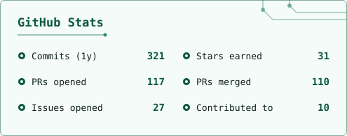

<a href="https://me.ihlecloud.de">
  <picture>
    <source media="(prefers-color-scheme: dark)" srcset="assets/banner-dark.jpg" />
    
  </picture>
</a>

<a href="https://me.ihlecloud.de">
  <picture>
    <source media="(prefers-color-scheme: dark)" srcset="https://readme-typing-svg.demolab.com?font=Fira+Code&weight=600&size=22&pause=1200&center=true&vCenter=true&width=620&color=7DDFB1&lines=Hi+there%2C+I'm+Fabian+%F0%9F%91%8B;PhD+student+%40+University+of+T%C3%BCbingen;P4+%C2%B7+MPLS+Network+Actions+%C2%B7+TSN;Bridging+research+and+open+source" />
    
  </picture>
</a>

<a href="https://me.ihlecloud.de"><picture><source media="(prefers-color-scheme: dark)" srcset="https://img.shields.io/badge/me.ihlecloud.de-0D1613?style=for-the-badge&logo=googlechrome&logoColor=5CC799" /></picture></a>
<a href="https://www.linkedin.com/in/fabian-ihle-a88a3729a/"><picture><source media="(prefers-color-scheme: dark)" srcset="https://img.shields.io/badge/LinkedIn-0D1613?style=for-the-badge&logo=data%3Aimage%2Fsvg%2Bxml%3Bbase64%2CPHN2ZyB4bWxucz0iaHR0cDovL3d3dy53My5vcmcvMjAwMC9zdmciIHZpZXdCb3g9IjAgMCAyNCAyNCI%2BPHBhdGggZmlsbD0iIzVDQzc5OSIgZmlsbC1ydWxlPSJldmVub2RkIiBkPSJNMyAxaDE4YTIgMiAwIDAgMSAyIDJ2MThhMiAyIDAgMCAxLTIgMkgzYTIgMiAwIDAgMS0yLTJWM2EyIDIgMCAwIDEgMi0yek01IDkuNXY5aDN2LTl6TTYuNSA0LjZhMS43IDEuNyAwIDEgMCAwIDMuNGExLjcgMS43IDAgMCAwIDAtMy40ek0xMC41IDkuNXY5aDN2LTQuOGMwLTEuMy42LTIgMS42LTJzMS40LjcgMS40IDJ2NC44aDN2LTUuNGMwLTIuNy0xLjQtMy44LTMuMy0zLjhjLTEuMyAwLTIuMi42LTIuNyAxLjRWOS41eiIvPjwvc3ZnPg%3D%3D" /></picture></a>
<a href="https://orcid.org/0009-0005-3917-2402"><picture><source media="(prefers-color-scheme: dark)" srcset="https://img.shields.io/badge/ORCID-0D1613?style=for-the-badge&logo=orcid&logoColor=5CC799" /></picture></a>
<a href="mailto:fabi@ihlecloud.de"><picture><source media="(prefers-color-scheme: dark)" srcset="https://img.shields.io/badge/fabi@ihlecloud.de-0D1613?style=for-the-badge&logo=maildotru&logoColor=5CC799" /></picture></a>

I'm a PhD student and research assistant at the [Chair of Communication Networks](https://uni-tuebingen.de/fakultaeten/mathematisch-naturwissenschaftliche-fakultaet/fachbereiche/informatik/lehrstuehle/kommunikationsnetze/), University of Tübingen. I work on **programmable data planes (P4 / Intel Tofino)**, **MPLS Network Actions** and **Time-Sensitive Networking**, and I like turning research ideas into open-source tools people actually use.

### 🛠️ Projects

|                                                              |                                                                                                           |
| ------------------------------------------------------------ | --------------------------------------------------------------------------------------------------------- |
| 🚀 **[P4TG](https://github.com/uni-tue-kn/P4TG)**             | P4-based traffic generator on Intel Tofino: generates and analyses up to 10 × 400 Gb/s of custom traffic. |
| 🦄 **[UniCorn-P4](https://github.com/uni-tue-kn/UniCorn-P4)** | Universal control plane and GUI for teaching and prototyping P4 programs on BMv2 and Intel Tofino.                         |
| 🎮 **[GW2RPC](https://github.com/Maselkov/GW2RPC)**           | Streams live Guild Wars 2 status into Discord Rich Presence.                                              |

### 📄 Selected publications

- **P4-TAS: P4-Based Time-Aware Shaper for Time-Sensitive Networking** · IEEE OJ-COMS, 2026 · [paper](https://ieeexplore.ieee.org/document/11478402)
- **High-Speed Generation of Periodic Traffic Patterns on P4TG for DDoS and Burst-Load Evaluation** · IEEE NetSoft, 2026 · [paper](https://doi.org/10.1109/NetSoft70012.2026.11603500)
- **Stack Management for MPLS Network Actions** · ACM/IRTF ANRW, 2025 · [paper](https://dl.acm.org/doi/10.1145/3744200.3744779)
- **P4-PSFP: P4-Based Per-Stream Filtering and Policing for TSN** · IEEE TNSM, 2024 · [paper](https://doi.org/10.1109/TNSM.2024.3434337)
- IETF drafts on [MNA signaling](https://datatracker.ietf.org/doc/draft-ihlesong-mpls-mna-signaling/) and [STAMP for MPLS extension headers](https://datatracker.ietf.org/doc/draft-gandhi-ippm-stamp-mpls-hdr/)

➡️ Full list on [me.ihlecloud.de](https://me.ihlecloud.de)

### 🧰 Tech I use

<picture>
  <source media="(prefers-color-scheme: dark)" srcset="https://skillicons.dev/icons?i=rust%2Cpython%2Cts%2Creact%2Cc%2Cbash%2Clinux%2Cdocker%2Cgit&theme=dark" />
  
</picture>

... and many more

### 📈 Activity

  <picture>
    <source media="(prefers-color-scheme: dark)" srcset="assets/stats-dark.svg" />
    
  </picture>
  <picture>
    <source media="(prefers-color-scheme: dark)" srcset="https://streak-stats.demolab.com?user=n1tr0-5urf3r&border_radius=6&background=0D1613&border=1A7B5080&stroke=1A7B50&ring=5CC799&fire=7DDFB1&currStreakNum=7DDFB1&sideNums=5CC799&currStreakLabel=5CC799&sideLabels=E2EEE8&dates=8FA69C" />
    
  </picture>

